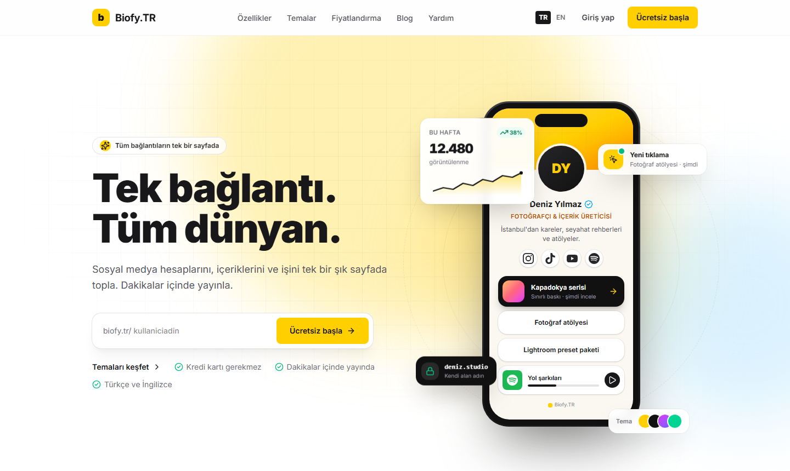
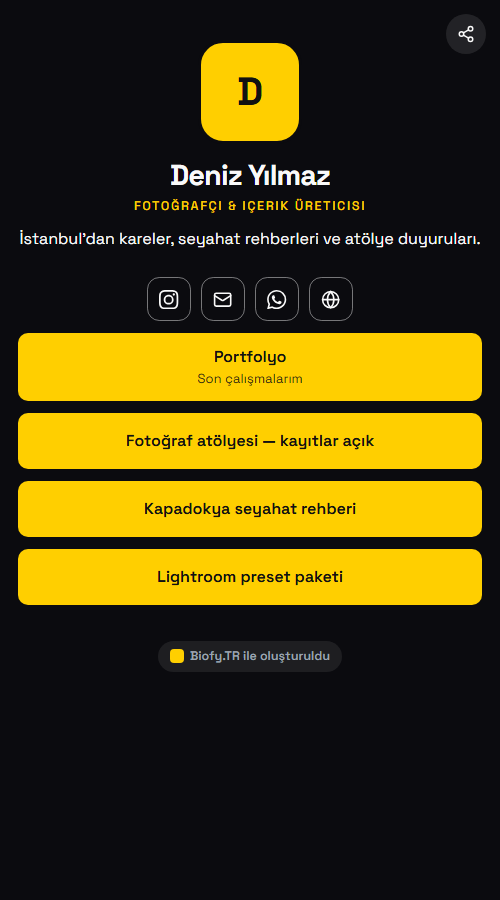
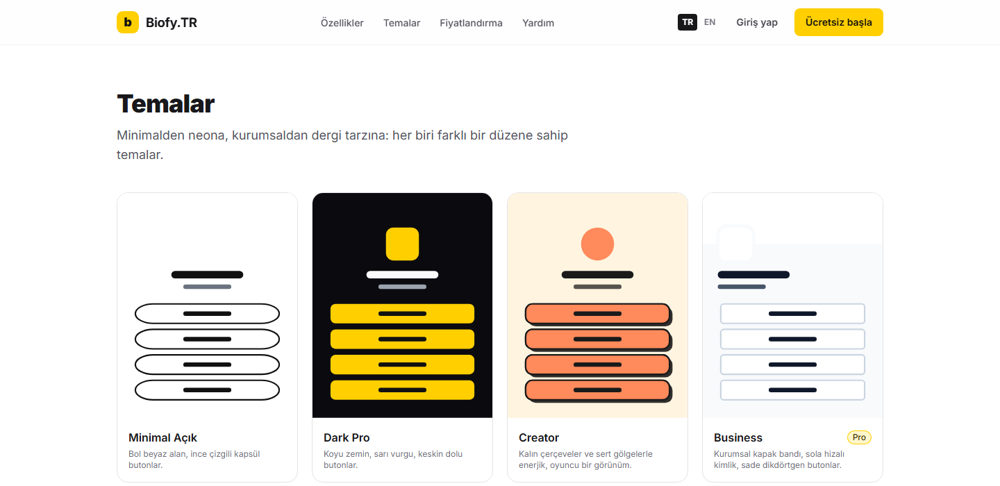

<div align="center">

<a href="https://biofy.tr"></a>

# Biofy.TR

**One link. Your whole world.**<br>
A self-hosted, multi-tenant link-in-bio platform: themes, content blocks, analytics and custom domains.

[](https://biofy.tr)
[](https://github.com/itsbykus/Biofy.TR/releases/latest)

[](https://github.com/itsbykus/Biofy.TR/actions/workflows/tests.yml)
[](https://github.com/itsbykus/Biofy.TR/actions/workflows/deployment-checks.yml)


[](LICENSE)

[Türkçe](README.tr.md) · **English**

**[🌐 See it live at biofy.tr](https://biofy.tr)** · [Download](https://github.com/itsbykus/Biofy.TR/releases/latest) · [Install](docs/INSTALLATION.md) · [Changelog](CHANGELOG.md)

<br>

<a href="https://biofy.tr"></a>

</div>

## See it live

**[https://biofy.tr](https://biofy.tr)** runs this repository. Open the landing page, browse the themes and pricing, or sign up for free and build your own page, which goes live at `https://biofy.tr/username`.

<table>
  <tr>
    <td width="36%" align="center" valign="top">
      <br>
      <sub><b>A published bio page</b>: Dark Pro theme, social icons, highlighted link</sub>
    </td>
    <td width="64%" align="center" valign="top">
      <br>
      <sub><b>12 distinct themes</b>, each with its own layout, typography and button style</sub>
    </td>
  </tr>
</table>

## Why Biofy.TR

- **Runs on the hosting you already have.** Upload a ZIP over FTP to shared (even WordPress) hosting and finish in a web installer. No SSH, Composer or Node.js is needed on the server. Or deploy with Docker on Coolify.
- **Privacy first.** Analytics without cookies and without storing IP addresses. Only strictly-necessary cookies are used.
- **Safe by default.** Strict CSP with nonces, TOTP two-factor authentication, host-header protection and a signed release manifest that the admin panel checks your uploaded files against.
- **Turkish and English** throughout: interface, e-mails and documentation.

## Features

| | Area | What you get |
|:-:|---|---|
| 👤 | **Accounts** | E-mail/password, e-mail verification, password reset, Google sign-in (OAuth/OIDC), TOTP 2FA + recovery codes, session management, security history, KVKK/GDPR data export and account deletion |
| 🧱 | **Editor** | 20 block types, drag-and-drop and keyboard reordering, live mobile/desktop preview, draft ↔ published, version history, multi-tab conflict protection, scheduled blocks |
| 🎨 | **Themes** | 12 themes; colours, gradients, image backgrounds, fonts, alignment (left/centre/right), button shape/border/shadow, social icon shape and brand colours, animation |
| 📦 | **Plans** | Basic / Pro / Premium with a central entitlement engine (platform limit → account status → per-user override → plan → default), quotas, time-limited assignments |
| 📈 | **Analytics** | Cookie-less view/click counting, bot and repeat filtering, daily aggregation, referrer/device/browser/country breakdowns, CSV export |
| 🌍 | **Custom domains** | DNS TXT ownership check, CNAME/A check, HTTPS verification, unknown hosts rejected |
| 🛠️ | **Administration** | Live dashboard, user/page moderation, plan and feature catalogue, CMS pages, blog and menus, landing-page and footer editor, brand, logo size, panel logo and bio page badge, e-mail templates, SMTP/Google settings, media, backup/restore, system health, one-click updates, audit logs |
| 🔌 | **API** | `/api/v1` REST API, hashed Sanctum tokens, abilities, per-token/per-user rate limits, OpenAPI 3 document |

**Stack:** Laravel 13 · PHP 8.3+ · MySQL 5.7+ / MariaDB 10.3+ · Blade · Tailwind CSS 4 (precompiled) · dependency-free JavaScript

## Quick start

<table>
  <tr>
    <th width="50%">🗂️ Shared (WordPress) hosting</th>
    <th width="50%">🐳 Coolify / Docker</th>
  </tr>
  <tr>
    <td valign="top">

1. Download **`biofy-tr-<version>.zip`** from the **Assets** of the [latest release](https://github.com/itsbykus/Biofy.TR/releases/latest) and check it against its `.sha256` file.
2. Upload it over FTP to a (sub)domain ([layouts](docs/SHARED_HOSTING.md)).
3. Create an **empty** MySQL/MariaDB database, separate from WordPress.
4. Open the domain; the web installer starts ([steps](docs/INSTALLATION.md)).

> ⚠️ Don't use GitHub's automatic "Source code" archives (`Biofy.TR-<version>.zip`): they contain neither `vendor/` nor `public/build/`.

</td>
    <td valign="top">

1. In Coolify, add this repository with the **Docker Compose** build pack and give the `app` service a domain.
2. Set `APP_URL`, `APP_KEY`, `DB_PASSWORD`, `DB_ROOT_PASSWORD` and the `BIOFY_ADMIN_*` variables for the first superadmin.
3. Press **Deploy**. Every push to GitHub deploys again, with an automatic backup before migrations ([details](docs/COOLIFY.md)).

</td>
  </tr>
</table>

Updating an existing install: [docs/UPDATE.md](docs/UPDATE.md).

<details>
<summary><b>💻 Development</b></summary>

<br>

Composer, npm and Node.js are only needed here (or in GitHub Actions), never on the hosting account.

```bash
composer install
npm ci && npm run build        # or npm run dev
cp .env.example .env && php artisan key:generate
# in .env: APP_ENV=local, APP_DEBUG=true and your database settings
php artisan migrate --seed
touch storage/app/private/installed.lock   # skip the web installer
php artisan serve
php artisan test                # 151 tests
php scripts/build-release.php   # FTP package -> dist/, verified by scripts/verify-release.php
```

</details>

## Documentation

[SECURITY](docs/SECURITY.md) is available in English; the other detailed documents are currently in Turkish.

| Document | Contents |
|---|---|
| [ARCHITECTURE](docs/ARCHITECTURE.md) | Modules, request flow, key decisions |
| [DATABASE](docs/DATABASE.md) | Tables, relations, indexes, tenant isolation |
| [SECURITY](docs/SECURITY.md) | Threat model and implemented measures |
| [DEPLOYMENT](docs/DEPLOYMENT.md) | Comparison of the two deployment methods, building a release package |
| [SHARED_HOSTING](docs/SHARED_HOSTING.md) | WordPress hosting requirements, layouts, file permissions |
| [COOLIFY](docs/COOLIFY.md) | Coolify setup, environment variables, automatic deployment, migrations, persistent data |
| [INSTALLATION](docs/INSTALLATION.md) · [UPDATE](docs/UPDATE.md) | Installation and update guides |
| [OPERATIONS](docs/OPERATIONS.md) | Cron, e-mail, backup/restore, domains, production checklist, known limitations |
| [API](docs/API.md) · [openapi.yaml](docs/openapi.yaml) | REST API |
| [TESTING](docs/TESTING.md) | Test suite, deployment tests and what is not covered |
| [CHANGELOG](CHANGELOG.md) | Release notes |
| [ROADMAP](docs/ROADMAP.md) | Payment readiness and next steps |

> [!NOTE]
> The legal pages (Privacy, Terms of Use, Cookies, KVKK) are editable **starting drafts**; have them reviewed by your legal counsel before going live.

## License

[MIT](LICENSE) · **[biofy.tr](https://biofy.tr)**
